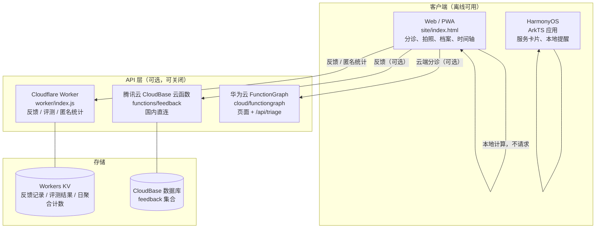
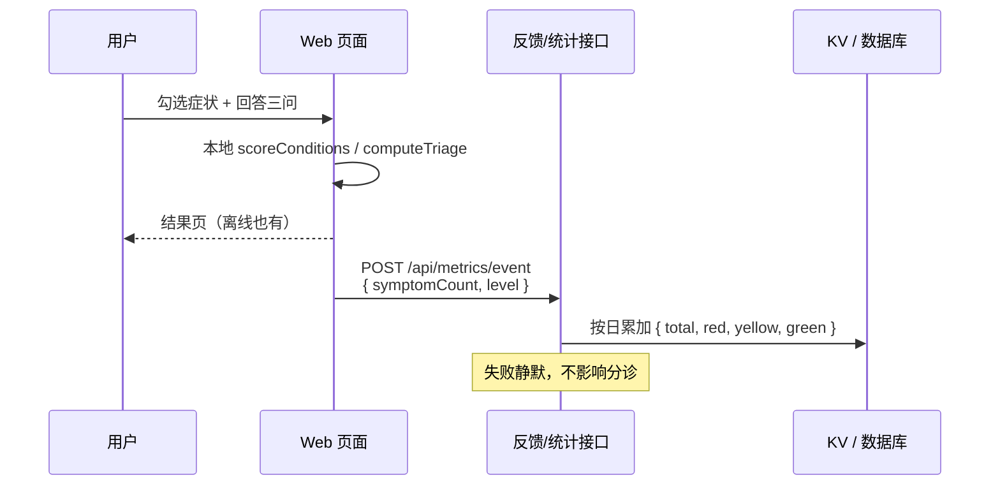
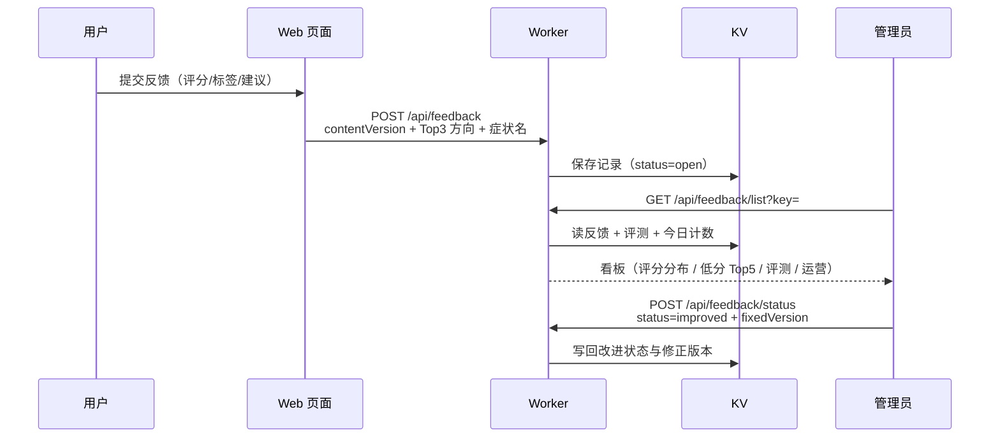
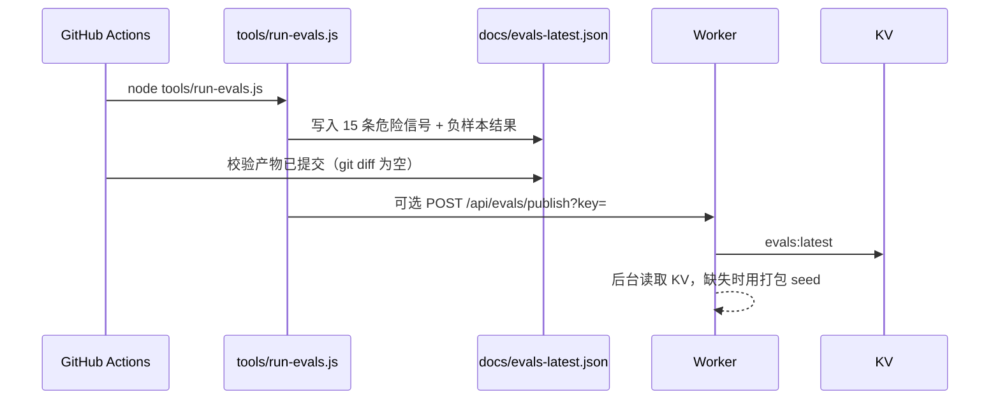
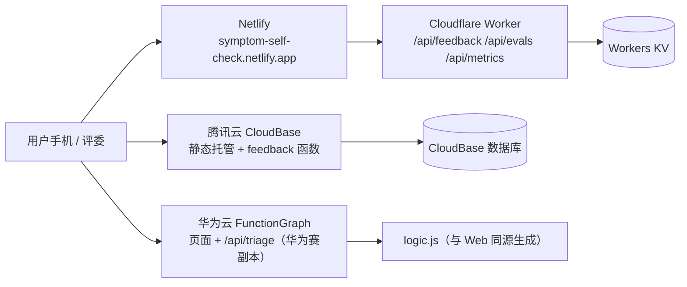

# 明辨康途 · 架构图

> 最后更新：2026-11-22 ｜ 对应内容版本：v1

## 1. 三层结构

**职责边界**

| 层 | 负责 | 不负责 |
| --- | --- | --- |
| 客户端 | 分诊计算、皮肤外观记录、档案/时间轴、PWA 离线 | 诊断、处方、账号 |
| API 层 | 收反馈、存评测、匿名日计数、可选云端分诊 | 诊断决策、存储健康档案、定时推送 |
| 存储 | 反馈与聚合计数 | 照片、年龄、长期用药、身份信息 |

## 2. 数据流

### 2.1 分诊与匿名统计

### 2.2 反馈 → 病症 → 改进 → 版本

### 2.3 评测跑批与发布

## 3. 部署拓扑

**可选性**：后端不可用时，页面仍可完成分诊、档案、时间轴、拍照；反馈会降级为「本机保存 + 复制到剪贴板」，匿名统计直接静默失败。

## 4. 关键设计取舍

- **单一数据源**：症状/疾病/危险信号写在 `site/index.html`，`gen-harmony-data.js` 与 `gen-cloud-logic.js` 生成鸿蒙与云端产物；CI 校验生成物一致。
- **后端只做展示与证据链**：不做定时推送、不做内容审核工作流、不做账号体系。
- **匿名优先**：运营事件只含症状数量与判红等级；反馈才含方向与症状名，且不传年龄/用药/照片。
- **离线兜底**：所有外发请求都允许失败，不阻塞分诊。